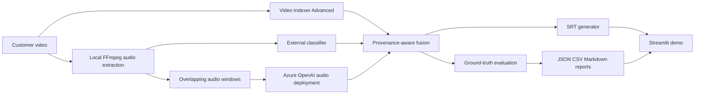

# AJN Accessible Video Captioning PoC

Customer-facing evaluation of AI-assisted non-speech audio captioning. The PoC compares:

1. Azure AI Video Indexer Advanced
2. Video Indexer plus a specialised audio classifier
3. Direct audio analysis using a configurable Azure OpenAI audio-capable deployment
4. A Video Indexer plus GPT hybrid

The objective is to maximise native Video Indexer capability and add complexity only where measured accessibility gaps remain. This project evaluates AJN-defined accessibility caption requirements; it does not establish regulatory compliance.

## Architecture



Provider integration is isolated under `providers/`; evaluation does not call Azure or model APIs. All provider output is normalised to one event schema containing event/test IDs, source, category, description, timing, confidence, timestamp source, raw response, and accessibility relevance.

## Prerequisites

- Python 3.11 or newer
- FFmpeg and FFprobe on `PATH`
- Azure CLI authenticated with `az login` for passwordless live calls
- For live tests, credentials for the providers selected in the UI

```powershell
python -m venv .venv
.\.venv\Scripts\Activate.ps1
python -m pip install -r requirements.txt
Copy-Item .env.example .env
```

## Azure configuration

Edit `.env`. Never commit it.

### Video Indexer

After deployment, load the AZD outputs:

```powershell
$env:AZURE_DEV_USER_AGENT='microsoft_foundry_skill'
azd env get-values
```

Set `VIDEO_INDEXER_ACCOUNT_ID`, `VIDEO_INDEXER_ACCOUNT_RESOURCE_ID`, and
`VIDEO_INDEXER_LOCATION` from those outputs. The provider uses `DefaultAzureCredential`
to request a short-lived Video Indexer account token. `VIDEO_INDEXER_ACCESS_TOKEN`
remains an optional troubleshooting fallback and is never logged.

### GPT audio deployment

Set `AZURE_OPENAI_ENDPOINT`, `AZURE_OPENAI_AUDIO_DEPLOYMENT`, and
`AZURE_OPENAI_API_VERSION` from the AZD outputs. The provider uses an Entra bearer
token from `DefaultAzureCredential`.

```text
AZURE_OPENAI_API_KEY=
```

`AZURE_OPENAI_API_KEY` is an optional compatibility fallback. The generated Azure AI
Services resource disables local authentication, so passwordless Entra authentication
is required for the provisioned environment. Audio is processed in configurable
overlapping windows. Window-derived events are labelled
`timestamp_source=audio_window`; model timestamps are never invented.

## Provision Azure dependencies

The approved deployment creates `rg-ajn-001` in Sweden Central.

```powershell
$env:AZURE_DEV_USER_AGENT='microsoft_foundry_skill'
azd env select ajn-001
azd provision
```

Deployment outputs contain resource identifiers and service endpoints, never keys.

### External classifier

Set `EXTERNAL_CLASSIFIER_ENDPOINT` and, when needed, `EXTERNAL_CLASSIFIER_API_KEY`. The endpoint must accept a multipart `audio` WAV file and return:

```json
{"events":[{"category":"siren","description":"siren wailing","start":1.2,"end":3.4,"confidence":0.9}]}
```

## Media and ground truth

1. Add/edit a scenario in `tests/manifest.json`.
2. Define expected category, description, approximate start/end, and `accessibility_critical`.
3. Start the UI and upload appropriately licensed customer media on the **Video Test** page.

No media is included. Uploaded media is saved locally under ignored `data/raw/` and is sent only to selected, explicitly configured providers.

## Run a test or benchmark

Launch the customer demo:

```powershell
python -m streamlit run streamlit_app.py
```

Select one scenario, upload its video, choose approaches, and click **Run test**. Repeat for each manifest scenario for the complete benchmark. `AJN-STRESS-001` is reserved for real Arabic/broadcast material with overlapping audio.

## Demo mode

Set `DEMO_MODE=true` to exercise UI and comparison behavior using fixtures. A prominent **SIMULATED DATA - DEMONSTRATION ONLY** banner is shown. Fixture output is written as `demo_results.json/csv`; customer benchmark Markdown generation is disabled for any simulated run.

For a quick smoke test, set `DEMO_MODE=true`, start Streamlit, select
`TEST-002 - Glass Breaking`, upload any non-confidential MP4 as the UI sample, keep
all four approaches selected, and click **Run test**. In demo mode the uploaded
file is not decoded or sent to a provider; fixture events drive the result.

The automated equivalent covers the demo benchmark, generated captions, and
fixture-result persistence:

```powershell
python -m pytest -q tests/test_demo_benchmark.py tests/test_demo_caption.py tests/test_demo_reporting.py
```

## Metrics

Expected and detected events match on category plus temporal overlap when both have timing. The evaluator calculates TP, FP, FN, precision, recall, F1, critical-event recall, and temporal intersection-over-union. Missing timing produces no fabricated IoU. Unexecuted/configuration-gated providers display **NOT TESTED** or **CONFIGURATION REQUIRED**, never `0%`.

Detection correctness is separate from human caption review. The UI captures 1-5 accuracy, accessibility relevance, and naturalness scores plus an over-description flag.

## Outputs

- `outputs/results.json` and `outputs/results.csv`: measured machine-readable output
- `outputs/demo_results.json` and `outputs/demo_results.csv`: fixture-only output
- `outputs/AJN_Accessible_Captioning_POC_Results.md`: measured customer results
- `outputs/AJN_Executive_Summary.md`: concise measured summary
- Downloadable SRT in the UI

Customer reports are generated only after a non-simulated run and contain no invented benchmark figures.

## Security and responsible AI

| Provider | Receives |
|---|---|
| Video Indexer | Selected video and service metadata |
| External classifier | Extracted mono WAV audio |
| Azure OpenAI audio | Overlapping WAV audio windows and the accessibility prompt |

- API keys/tokens belong only in `.env`.
- Full transcripts are not logged.
- `LOG_REDACTION=true` is the safe default.
- Do not submit confidential media to a provider without customer approval.
- Ground truth, model output, human judgement, and fusion are represented separately.
- Do not infer sensitive characteristics from media.
- Human review and separate regulatory validation remain required.

## Testing

```powershell
python -m pytest -q
python -m compileall app providers evaluation captioning reports config streamlit_app.py
```

Live integrations require credentials and billable Azure resources. Unit tests do not call external services.

## Troubleshooting

- **CONFIGURATION REQUIRED**: populate the relevant `.env` values, then restart Streamlit.
- **Audio extraction failed**: install FFmpeg or set `FFMPEG_PATH` to its executable.
- **Video Indexer 401/403**: refresh the account access token and verify account/location.
- **GPT input audio rejected**: verify deployment capability and `AZURE_OPENAI_API_VERSION`.
- **No metric percentage**: define ground truth and run the provider; mathematically undefined values stay `NOT TESTED`.
- **Streamlit retains an old run**: use Streamlit's rerun/clear-cache controls after changing `.env`.

## Known limitations

- The external classifier contract is intentionally generic; deploy/choose the classifier separately.
- Provider event taxonomies may require an AJN-approved category mapping for production evaluation.
- GPT window timing bounds the event to a window and is less precise than native VI timing.
- Video Indexer account access-token acquisition is intentionally outside this PoC.
- Batch orchestration, durable job storage, authentication, cost telemetry, and production retention controls are out of scope.
- The UI stores one active run in Streamlit session state; run artifacts are not a production database.
